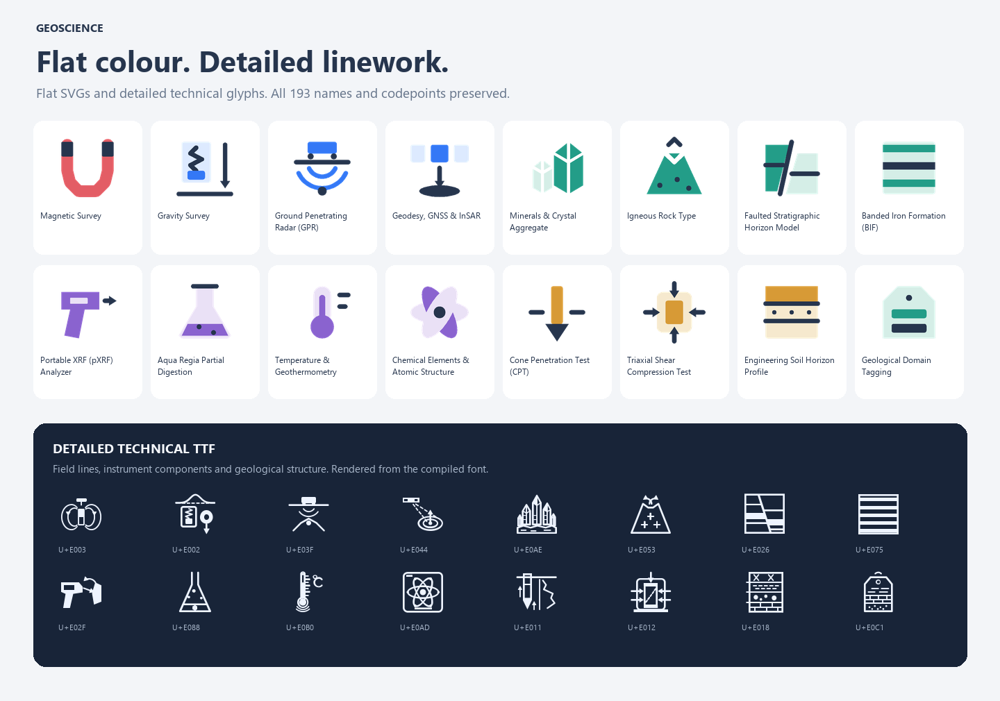

<div align="center">

# EarthScience Icons

**A visual language for Earth science.**

193 specialist icons for geophysics, geology, geochemistry and geotechnical engineering.

**Detailed linework · Flat colour · SVG · TTF · WOFF · Public domain**

[**Explore every icon →**](https://APethick.github.io/EarthScienceIcons/) · [Download the set](https://APethick.github.io/EarthScienceIcons/assets/EarthScienceIcons.zip) · [TTF font](dist/GeoScienceIcons.ttf) · [Icon manifest](dist/geoscience-icons.json)



</div>

## The collection

The library covers field and laboratory methods, Earth models and scientific processes. The detailed font preserves raypaths, electrodes, magnetic field lines, instrument components, crystal faces, rock textures and chart boundaries. Flat SVGs provide a simpler colour style for visual interfaces and illustrations.

| Discipline | Icons | Examples |
| --- | ---: | --- |
| Geophysical | 39 | Seismic reflection, magnetotellurics, gravity, GPR, petrophysics |
| Geological | 59 | Mapping, drilling, stratigraphy, faults, folds, minerals |
| Geochemical | 73 | XRF, ICP-MS, assays, geochemical diagrams, thermodynamics |
| Geotechnical | 22 | SPT, CPT, triaxial testing, rock quality, slope stability |
| **Total** | **193** | **59 methods · 85 Earth model types · 49 processes** |

The [interactive library](https://APethick.github.io/EarthScienceIcons/) shows every icon. Search names and keywords, filter by discipline or category, compare both styles, change the preview size, and copy integration code.

## Using the icons

### SVG

Flat colour artwork: [`dist/svg/`](dist/svg/). Detailed monochrome artwork: [`dist/svg-mono/`](dist/svg-mono/).

```html

```

Detailed SVGs use `currentColor` when included inline. An SVG loaded through `` does not inherit the page's text colour.

### Icon font

Copy `geoscience-icons.css`, `GeoScienceIcons.woff` and `GeoScienceIcons.ttf` from `dist/` into the same directory:

```html
<link rel="stylesheet" href="geoscience-icons.css">
<i class="gi gi-gp-seismic-reflection" aria-hidden="true"></i>
```

```css
.gi { font-size: 32px; color: #26354d; }
```

Pair decorative glyphs with visible text. Give icon-only buttons accessible names. Detailed glyphs reveal more internal structure at 32 px and above; check the size that suits your interface.

The family name is `GeoScience Icons`. Codepoints span `U+E001`–`U+E0C1`. Existing IDs, CSS classes, printable fallback keys and codepoints are preserved. The manifest contains every mapping, description and keyword.

### Java / Opus

[`dist/GeoScienceIcons.java`](dist/GeoScienceIcons.java) provides the ControlsFX `GlyphFont` binding for Opus:

```java
org.controlsfx.glyphfont.Glyph icon = GeoScienceIcons.createGlyph(
    GeoScienceIcons.Glyph.GP_SEISMIC_REFLECTION,
    32
);
```

The binding depends on ControlsFX, Log4j and the existing Opus resource loader.

## Build and preview

Use Python 3.10 or newer:

```sh
python -m pip install -r requirements.txt
python build_font.py
python build_site.py
python -m http.server 8080 --directory docs
```

Open `http://localhost:8080`. The website is static, with no npm build or external asset dependencies.

`build_font.py` generates both SVG styles, fonts, CSS, the manifest, Java binding and specimens. `build_site.py` updates Pages assets and the downloadable ZIP. Commit generated outputs with source changes to keep the site and downloads in sync.

| Path | Purpose |
| --- | --- |
| `icons_*.py` | Scientific metadata and detailed discipline builders |
| `font_artwork.py` | Detailed glyph corrections, cleanup and optical fit |
| `icon_artwork.py` | Flat colour artwork |
| `geom_utils.py` | Geometry primitives |
| `build_font.py` | Font and vector compilation |
| `icon_specimen.py` | Local catalog and specimens |
| `dist/` | Ready-to-use distribution |
| `docs/` | GitHub Pages website |

The normal build only writes inside the repository. `python build_font.py --install-opus` also copies the font and Java binding into an existing `C:\projects\opus\opus.base` checkout.

## GitHub Pages

The workflow publishes `docs/` on pushes to `main`. In **Settings → Pages**, select **GitHub Actions** as the source. The site is served at [apethick.github.io/EarthScienceIcons](https://APethick.github.io/EarthScienceIcons/).

## Contributing

Keep IDs and codepoints stable. Add scientific detail deliberately, preserve a clear silhouette, and check the compiled font as well as the SVG. Use explicit Java types in examples and bindings.

Electric features are blue, magnetic features are red, and receivers are yellow with black outlines in the flat artwork.

## Licence

Public domain under the [Unlicense](LICENSE). Use, modify and distribute the icons in personal, academic and commercial work.
