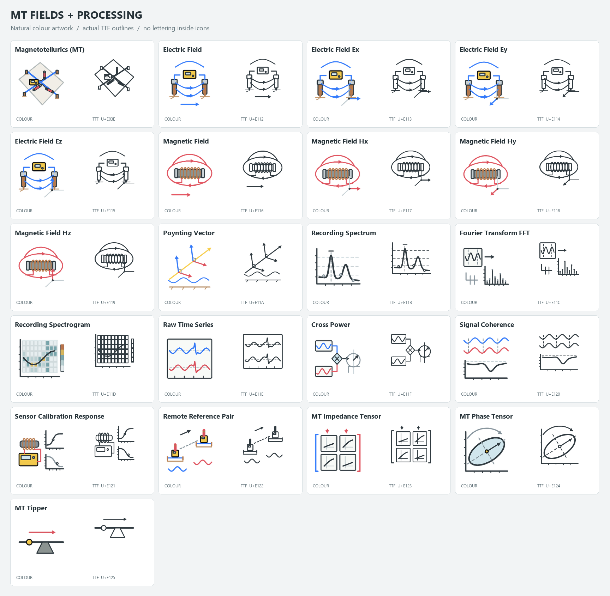
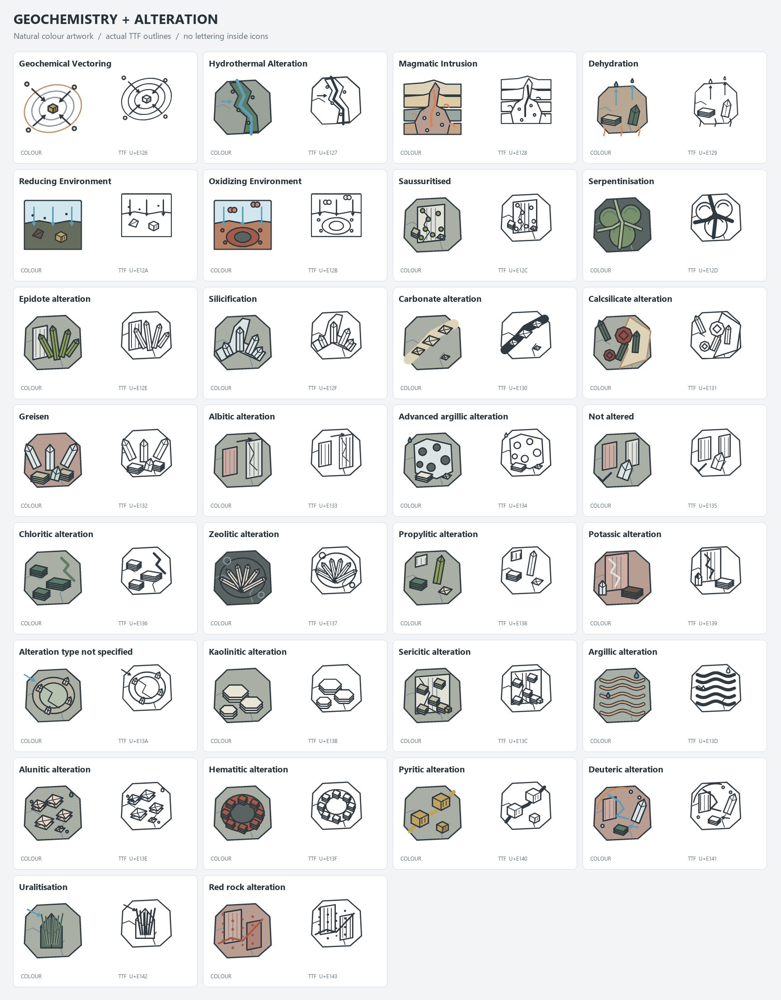
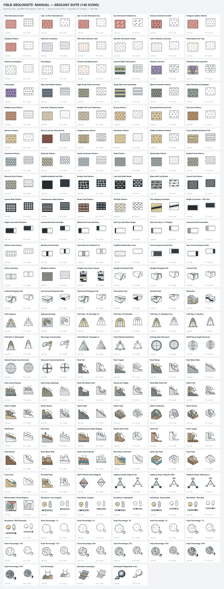

<div align="center">

# EarthScience Icons

**A visual language for Earth science.**

471 specialist icons for geophysics, geology, geochemistry and geotechnical engineering.

**Detailed linework · Flat colour · SVG · TTF · WOFF · Public domain**

[**Explore every icon →**](https://APethick.github.io/EarthScienceIcons/) · [Download the set](https://APethick.github.io/EarthScienceIcons/assets/EarthScienceIcons.zip?v=2.8.0) · [TTF font](dist/GeoScienceIcons.ttf) · [Icon manifest](dist/geoscience-icons.json)


</div>

## The collection

The library covers field and laboratory methods, Earth models and scientific processes. The detailed font preserves raypaths, electrodes, magnetic field lines, instrument components, crystal faces, rock textures and chart boundaries. The flat colour SVGs now use the same detailed technical compositions, with representative material colours for rock, soil, water, vegetation, glass and metal rather than discipline colour themes. Abstract plots use neutral ink. Material colours are illustrative rather than a scientific classification legend.

| Discipline | Icons | Examples |
| --- | ---: | --- |
| Geophysical | 139 | Seismic reflection, magnetotellurics, gravity, GPR, petrophysics |
| Geological | 207 | Mapping, stratigraphy, folds, lithological patterns, mass movements, QAPF & stereonets |
| Geochemical | 103 | XRF, ICP-MS, assays, geochemical diagrams, thermodynamics |
| Geotechnical | 22 | SPT, CPT, triaxial testing, rock quality, slope stability |
| **Total** | **471** | **145 methods · 182 Earth model types · 132 processes · 12 petrophysical quantities** |

The [interactive library](https://APethick.github.io/EarthScienceIcons/) shows every icon. Search names and keywords, filter by discipline or category, compare both styles, change the preview size, and copy integration code.

## Geophysics expansion

The collection includes **139 geophysics icons**, with 80 additions covering:

- AEM, fixed-wing systems, VTEM, SkyTEM, Loupe, FDEM, TDEM, ground TEM loop arrangements, LOTEM, terrestrial/marine CSEM and CSAMT.
- GPR radargrams, time slices, volumes, CMP/WARR velocity analysis, utility/rebar detection, borehole radar and antennas.
- Total-count radiometrics, potassium, equivalent uranium, equivalent thorium, ternary display and airborne gamma spectrometry.
- Crosshole, downhole, uphole, VSP, refraction, MASW and passive H/V seismic methods; a broad borehole logging and tomography suite.
- Conductivity, resistivity, density, magnetic susceptibility, remanence, chargeability, Vp, Vs, porosity, permeability, dielectric permittivity and thermal conductivity.

The original 193 IDs, codepoints and fallback keys are preserved. The MT acquisition symbol was deliberately simplified from a user-supplied field-layout reference; all other original drawings are preserved. SP was already present and remains at `U+E03D`; a separate borehole SP icon is now included. New glyphs occupy `U+E0C2`–`U+E111`.

[View the new geophysics catalog and references](docs/geophysics.md).


### Detailed EM equipment

The EM suite uses equipment-led drawings: clothed field operators with backpack instruments and tablets, airframes with cockpit and rotor detail, suspension bridles, distinct VTEM and SkyTEM coil frames, and ground loops with cables, controllers and receivers. Both styles share the same compositions. Existing IDs and Unicode mappings remain stable.


### Detailed petrophysics

All 12 quantity icons use physical specimens and measurement detail: electrode contacts and core textures, density balance and dimensions, magnetic coils and oriented domains, polarization decay, ultrasonic source/receiver ends, isolated versus connected pore spaces, dielectric plates, and thermal contacts. Ten related borehole tools include layered formations, fluid-filled holes, sonde components and log tracks. Both styles share the drawings; names and codepoints remain stable.


[View the detailed logging-tool preview](dist/petrophysics_logging_preview.png).

## Using the icons

### SVG

Flat colour artwork: [`dist/svg/`](dist/svg/). Detailed monochrome artwork: [`dist/svg-mono/`](dist/svg-mono/).

```html

```

Detailed SVGs use `currentColor` when included inline. An SVG loaded through `` does not inherit the page's text colour.

### Icon font

Copy `geoscience-icons.css`, `GeoScienceIcons.woff` and `GeoScienceIcons.ttf` from `dist/` into the same directory:

```html
<link rel="stylesheet" href="geoscience-icons.css">
<i class="gi gi-gp-seismic-reflection" aria-hidden="true"></i>
```

```css
.gi { font-size: 32px; color: #26354d; }
```

Pair decorative glyphs with visible text. Give icon-only buttons accessible names. Detailed glyphs reveal more internal structure at 32 px and above; check the size that suits your interface.

The family name is `GeoScience Icons`. Codepoints span `U+E001`–`U+E1D7`. Existing IDs, CSS classes, printable fallback keys and codepoints are preserved. The manifest contains every mapping, description, reference and keyword.

### Java / Opus

[`dist/GeoScienceIcons.java`](dist/GeoScienceIcons.java) provides the ControlsFX `GlyphFont` binding for Opus:

```java
org.controlsfx.glyphfont.Glyph icon = GeoScienceIcons.createGlyph(
    GeoScienceIcons.Glyph.GP_SEISMIC_REFLECTION,
    32
);
```

The binding depends on ControlsFX, Log4j and the existing Opus resource loader.

## Build and preview

Use Python 3.10 or newer:

```sh
python -m pip install -r requirements.txt
python build_font.py
python build_site.py
python tests/verify_distribution.py
python -m http.server 8080 --directory docs
```

Open `http://localhost:8080`. The website is static, with no npm build or external asset dependencies.

`build_font.py` generates both SVG styles, fonts, CSS, the manifest, Java binding and specimens. `build_site.py` updates Pages assets and the downloadable ZIP. Commit generated outputs with source changes to keep the site and downloads in sync. For flat-only changes, run `python build_flat.py` followed by `python build_site.py`; this leaves the detailed TTF, WOFF and monochrome SVGs unchanged.

| Path | Purpose |
| --- | --- |
| `icons_*.py` | Scientific metadata and detailed discipline builders |
| `font_artwork.py` | Detailed glyph corrections, cleanup and optical fit |
| `em_artwork.py` | Detailed EM equipment, operators, aircraft and acquisition layouts |
| `petrophysics_artwork.py` | Rock specimens, property measurements and petrophysical logging tools |
| `detailed_flat.py` | Flat material-colour layers from the detailed font builders |
| `icon_materials.py` | Object-specific material assignments |
| `icon_artwork.py` | SVG conversion and original simplified recipes |
| `geom_utils.py` | Geometry primitives |
| `build_font.py` | Font and vector compilation |
| `icon_specimen.py` | Local catalog and specimens |
| `dist/` | Ready-to-use distribution |
| `docs/` | GitHub Pages website |
| `tests/` | Distribution checks and published glyph compatibility fixture |

The normal build only writes inside the repository. `python build_font.py --install-opus` also copies the font and Java binding into an existing `C:\projects\opus\opus.base` checkout.

On Windows, run `build_and_push.bat` from this folder to build and verify the distribution, merge generated glyph mappings into `C:\projects\opus\opus.base`, update both Opus font copies, and commit and push the icon repository's `main` branch. The script requires Python 3.10+, the packages in `requirements.txt`, Git access to `origin`, and an existing Opus checkout. It stops on failure or if the Git index already contains staged changes. It stages icon source, documentation, tests, and generated distribution and website assets. Opus changes remain in the Opus working tree.

## GitHub Pages

The workflow publishes `docs/` on pushes to `main`. In **Settings → Pages**, select **GitHub Actions** as the source. The site is served at [apethick.github.io/EarthScienceIcons](https://APethick.github.io/EarthScienceIcons/).

## Contributing

Keep IDs and codepoints stable. Add scientific detail deliberately, preserve a clear silhouette, and check the compiled font as well as the SVG. Use explicit Java types in examples and bindings.

Electric features are blue, magnetic features are red, and receivers are yellow with black outlines in the flat artwork.

## Licence

Public domain under the [Unlicense](LICENSE). Use, modify and distribute the icons in personal, academic and commercial work.

## MT fields and processing (2.5)

Twenty text-free icons cover E/H fields and their spatial components, Poynting flux, spectrum, FFT, spectrogram, sampled waveforms, cross power, coherence, coil calibration, remote references, impedance tensor, phase tensor and tipper. Existing IDs remain stable. Electric is blue, magnetic red, Poynting yellow; receivers are yellow with black outlines. Copper, ferrite, soil, glass and metal use representative material colours.



## Geochemistry and alteration (2.6)

Thirty additions cover geochemical vectoring, hydrothermal alteration, magmatic intrusion, dehydration, reducing and oxidizing environments, and every one of the 24 Opus AlterationType descriptors, including not altered and alteration not specified. Copper, quartz, feldspar, epidote, chlorite, clay, pyrite and hematite use representative natural mineral colours. Habit, texture, reaction rims and assemblages distinguish the monochrome versions; no lettering is drawn inside the icons. Bare descriptor IDs resolve through the Java lookup; `GeoScienceIcons.forProperty(alteration)` accepts the existing Opus enum.



## Field Geologists' Manual — Geology expansion (2.7)

148 text-free geological icons (`U+E144`–`U+E1D7`) under the `Geological` (`gl_`) banner reference D. A. Berkman (ed.), *Field Geologists' Manual*, 4th ed., AusIMM Monograph 9:

- **Tectonic & lithological map patterns (§19.4–19.6 & §5.6.2)**: post-/late-/syn-kinematic and gneissic granites, gabbro-diorite, porphyry, island-arc/rift/calc-alkaline/alkaline volcanics, flood basalts, dolerite-granophyre, keratophyre, layered mafic-ultramafic intrusions, kimberlite, carbonatite, slate/phyllite, high-grade schist/gneiss, hornfels, tuffs, breccias, gossan, clastic and carbonate patterns, cherts, coal lithotype patterns and graphic coal seam columns.
- **Structural geology & stereonets (§5.1, §5.10, §5.14–5.15, §6.10)**: 3D fold attitude block diagrams (upright horizontal through recumbent and reclined), monocline, fold vergence, superposed folds, Ramsay dip-isogon classes (1A, 1B, 1C, 2, 3) and construction with protractor, Fleuty/Rickard fold attitude triangular diagrams, Orthographic/Wulff/Schmidt stereonets and stereonet contouring devices.
- **Mass movement & landslides (after Varnes)**: 30 cross-sectional block diagrams spanning bedrock, debris, earth and complex falls, topples, rotational slumps, planar slides, lateral spreads, creeps, cambering/valley bulging, wet sand/silt flows, quick clay flows, earth flows, loess flows and dry sand flows.
- **Petrology, sedimentology & stratigraphy (§1, §2.4.1, §2.6, §9.9)**: IUGS QAPF plutonic double triangle and gabbroic rock ternaries with mineral habit glyphs, P-T metamorphic facies diagram, 6 roundness/sphericity classes, 12 visual percentage estimation charts (1%–50%), unit and boundary stratotypes (GSSP), and earthquake magnitude vs energy comparison.



## Spectroscopy expansion (2.8)

The Gibbs free energy icon separates the Delta-G label from its equilibrium curve. Water activity uses a symmetric curved droplet. The existing XRD icon retains its ID and now separates the powder diffraction geometry from its peak trace. These three redraws affect both colour SVGs and monochrome glyphs.

Thirteen appended icons cover laboratory and satellite hyperspectral acquisition, a data cube, contiguous band selection, a recorded spectral signature, UV, VIS, VNIR, NIR, IR, SWIR, MWIR and TIR/LWIR. Spectral windows and curves are schematic: wavelength coverage depends on the instrument. Reflectance troughs indicate absorption; thermal measurements use emitted radiance or emissivity.

Spectral terminology references: [USGS imaging spectroscopy overview](https://pubs.usgs.gov/publication/70240743), [NASA/JPL hyperspectral thermal emission spectrometer](https://hytes.jpl.nasa.gov/).
