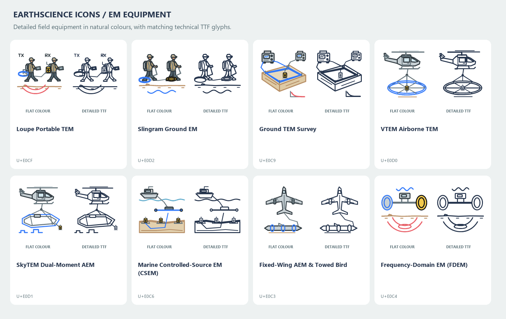
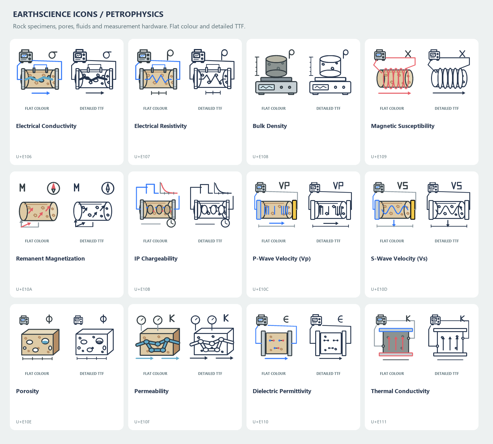
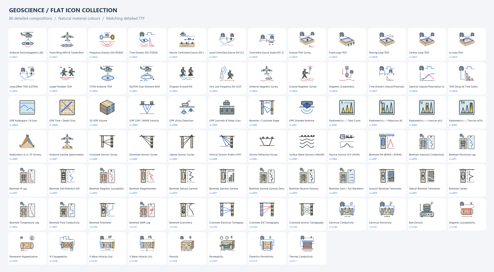

# Expanded geophysics catalog

80 additions. The original 193 icon mappings and glyphs are preserved.

The EM equipment drawings were refined in version 2.3.0. Portable systems show clothed operators, backpacks, harnesses, tablets and distinct transmitter/receiver hardware. Airborne systems include airframe, rotor, cockpit, bridle and coil-frame detail; ground systems include controllers, cables and receiver housings. The flat SVGs and technical font use the same drawings.

Version 2.4.0 refines all 12 petrophysical quantity icons and 10 associated logging tools. Rock texture, pore geometry, fluid pathways and measurement components distinguish the quantities. Logging illustrations show formation layers, borehole fluid, source/receiver or electrode arrangements, and response tracks.

[Petrophysical logging tools: flat SVG and detailed TTF](../dist/petrophysics_logging_preview.png)

| Codepoint | Icon | ID |
| --- | --- | --- |
| U+E0C2 | Airborne Electromagnetics (AEM) | `gp_airborne_em_aem` |
| U+E0C3 | Fixed-Wing AEM & Towed Bird | `gp_fixed_wing_aem` |
| U+E0C4 | Frequency-Domain EM (FDEM) | `gp_frequency_domain_em_fdem` |
| U+E0C5 | Time-Domain EM (TDEM) | `gp_time_domain_em_tdem` |
| U+E0C6 | Marine Controlled-Source EM (CSEM) | `gp_csem_marine` |
| U+E0C7 | Land Controlled-Source EM (CSEM) | `gp_csem_land` |
| U+E0C8 | Controlled-Source Audio-MT (CSAMT) | `gp_csamt` |
| U+E0C9 | Ground TEM Survey | `gp_ground_tem` |
| U+E0CA | Fixed-Loop TEM | `gp_tem_fixed_loop` |
| U+E0CB | Moving-Loop TEM | `gp_tem_moving_loop` |
| U+E0CC | Central-Loop TEM | `gp_tem_central_loop` |
| U+E0CD | In-Loop TEM | `gp_tem_in_loop` |
| U+E0CE | Long-Offset TEM (LOTEM) | `gp_tem_lotem` |
| U+E0CF | Loupe Portable TEM | `gp_loupe_tem` |
| U+E0D0 | VTEM Airborne TEM | `gp_vtem` |
| U+E0D1 | SkyTEM Dual-Moment AEM | `gp_skytem` |
| U+E0D2 | Slingram Ground EM | `gp_slingram_em` |
| U+E0D3 | Very Low Frequency EM (VLF) | `gp_vlf_em` |
| U+E0D4 | Airborne Magnetic Survey | `gp_airborne_magnetics` |
| U+E0D5 | Ground Magnetic Survey | `gp_ground_magnetics` |
| U+E0D6 | Magnetic Gradiometry | `gp_magnetic_gradiometry` |
| U+E0D7 | Time-Domain Induced Polarization | `gp_electrical_ip_chargeability` |
| U+E0D8 | Spectral Induced Polarization (SIP) | `gp_ip_spectral` |
| U+E0D9 | TEM Decay & Time Gates | `gp_tem_decay_gates` |
| U+E0DA | GPR Radargram / B-Scan | `gp_gpr_b_scan` |
| U+E0DB | GPR Time / Depth Slice | `gp_gpr_time_slice` |
| U+E0DC | 3D GPR Volume | `gp_gpr_volume_3d` |
| U+E0DD | GPR CMP / WARR Velocity | `gp_gpr_cmp_velocity` |
| U+E0DE | GPR Utility Detection | `gp_gpr_utility_detection` |
| U+E0DF | GPR Concrete & Rebar Scan | `gp_gpr_concrete_rebar` |
| U+E0E0 | Borehole / Crosshole Radar | `gp_gpr_borehole` |
| U+E0E1 | GPR Shielded Antenna | `gp_gpr_antenna` |
| U+E0E2 | Radiometrics — Total Count | `gp_radiometrics_total` |
| U+E0E3 | Radiometrics — Potassium (K) | `gp_radiometrics_potassium_k` |
| U+E0E4 | Radiometrics — Uranium (eU) | `gp_radiometrics_uranium_u` |
| U+E0E5 | Radiometrics — Thorium (eTh) | `gp_radiometrics_thorium_th` |
| U+E0E6 | Radiometric K–U–Th Ternary | `gp_radiometrics_ternary` |
| U+E0E7 | Airborne Gamma Spectrometry | `gp_airborne_radiometrics` |
| U+E0E8 | Crosshole Seismic Survey | `gp_seismic_crosshole` |
| U+E0E9 | Downhole Seismic Survey | `gp_seismic_downhole` |
| U+E0EA | Uphole Seismic Survey | `gp_seismic_uphole` |
| U+E0EB | Vertical Seismic Profile (VSP) | `gp_seismic_vsp` |
| U+E0EC | Seismic Refraction Survey | `gp_seismic_refraction` |
| U+E0ED | Surface-Wave Seismics (MASW) | `gp_seismic_masw` |
| U+E0EE | Passive Seismic H/V (HVSR) | `gp_seismic_hvsr` |
| U+E0EF | Borehole EM (BHEM / DHEM) | `gp_borehole_em_bhem` |
| U+E0F0 | Borehole Induction Conductivity | `gp_borehole_induction_log` |
| U+E0F1 | Borehole Resistivity Log | `gp_borehole_resistivity_log` |
| U+E0F2 | Borehole IP Log | `gp_borehole_ip_log` |
| U+E0F3 | Borehole Self-Potential (SP) | `gp_borehole_sp_log` |
| U+E0F4 | Borehole Magnetic Susceptibility | `gp_borehole_magnetic_susceptibility` |
| U+E0F5 | Borehole Magnetometer | `gp_borehole_magnetometer` |
| U+E0F6 | Borehole Natural Gamma | `gp_borehole_natural_gamma` |
| U+E0F7 | Borehole Spectral Gamma | `gp_borehole_spectral_gamma` |
| U+E0F8 | Borehole Gamma-Gamma Density | `gp_borehole_density_log` |
| U+E0F9 | Borehole Neutron Porosity | `gp_borehole_neutron_porosity` |
| U+E0FA | Borehole Sonic / Full Waveform | `gp_borehole_sonic_log` |
| U+E0FB | Acoustic Borehole Televiewer | `gp_borehole_acoustic_televiewer` |
| U+E0FC | Optical Borehole Televiewer | `gp_borehole_optical_televiewer` |
| U+E0FD | Borehole Caliper | `gp_borehole_caliper` |
| U+E0FE | Borehole Temperature Log | `gp_borehole_temperature` |
| U+E0FF | Borehole Fluid Conductivity | `gp_borehole_fluid_conductivity` |
| U+E100 | Borehole Flowmeter | `gp_borehole_flowmeter` |
| U+E101 | Borehole NMR Log | `gp_borehole_nmr` |
| U+E102 | Borehole Gravimetry | `gp_borehole_gravity` |
| U+E103 | Crosshole Electrical Tomography | `gp_crosshole_ert` |
| U+E104 | Crosshole EM Tomography | `gp_crosshole_em_tomography` |
| U+E105 | Crosshole Seismic Tomography | `gp_crosshole_seismic_tomography` |
| U+E106 | Electrical Conductivity | `gp_property_conductivity` |
| U+E107 | Electrical Resistivity | `gp_property_resistivity` |
| U+E108 | Bulk Density | `gp_property_density` |
| U+E109 | Magnetic Susceptibility | `gp_property_magnetic_susceptibility` |
| U+E10A | Remanent Magnetization | `gp_property_remanent_magnetization` |
| U+E10B | IP Chargeability | `gp_property_chargeability` |
| U+E10C | P-Wave Velocity (Vp) | `gp_property_vp` |
| U+E10D | S-Wave Velocity (Vs) | `gp_property_vs` |
| U+E10E | Porosity | `gp_property_porosity` |
| U+E10F | Permeability | `gp_property_permeability` |
| U+E110 | Dielectric Permittivity | `gp_property_dielectric_permittivity` |
| U+E111 | Thermal Conductivity | `gp_property_thermal_conductivity` |

## Equipment and method references

Drawings are schematic compositions based on acquisition geometry and measurement principles. Natural colours describe materials; blue electric features, red magnetic features and yellow receivers retain the library conventions.

- [Loupe Geophysics: portable TEM](https://www.loupegeophysics.com.au/) — two-person walking transmitter/receiver system.
- [Design + Industry: Loupe equipment design](https://www.design-industry.com.au/loupe) — backpack hardware, operator tablets and the transmitter loop positioned behind the operator.
- [Geotech: VTEM](https://www.geotech.ca/services/electromagnetic/vtem-versatile-time-domain-electromagnetic-system/) — coincident transmitter/receiver configuration.
- [SkyTEM: system overview](https://skytem.com/wp-content/uploads/2024/06/SkyTEM_Systems.pdf) — rigid frames, offset receiver and low/high moments.
- [EMGS: marine CSEM](https://emgs.com/technology/a-guide-to-marine-em/csem/) — towed horizontal electric dipole and seabed receivers.
- [USGS: borehole geophysics](https://www.usgs.gov/centers/new-york-water-science-center/science/borehole-geophysics) and [logging method summary](https://water.usgs.gov/ogw/bgas/logging_table.html) — induction, SP, resistivity, gamma, caliper, fluid measurements and imaging.
- [EPA: acoustic televiewer](https://www.epa.gov/environmental-geophysics/borehole-acoustic-televiewer-atv) — rotating transducer and unwrapped sinusoidal wall image.
- [Sensors & Software: GPR](https://www.sensoft.ca/support/faq/) — diffraction, CMP/WARR and utility/rebar acquisition.

Radiometric uranium and thorium channels are labelled eU and eTh because concentrations are conventionally inferred from daughter-product gamma emissions. Quantity icons distinguish physical properties from the existing Earth-model icons.
